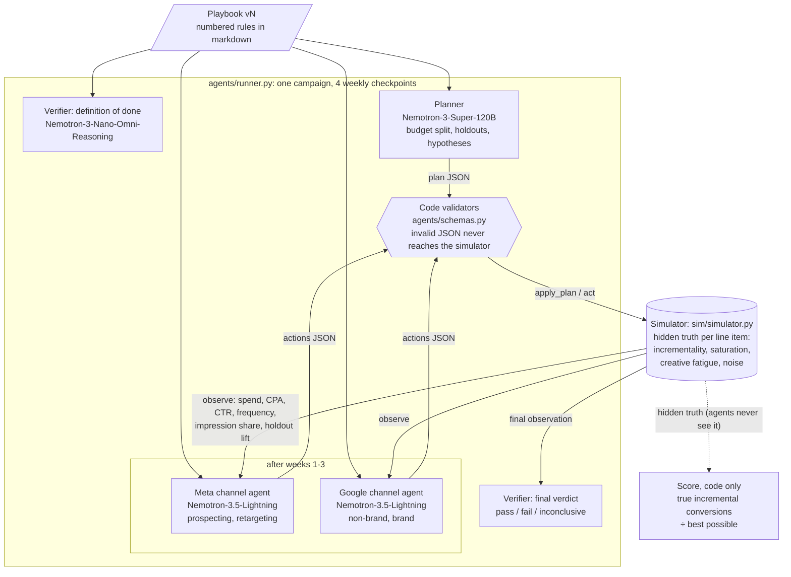
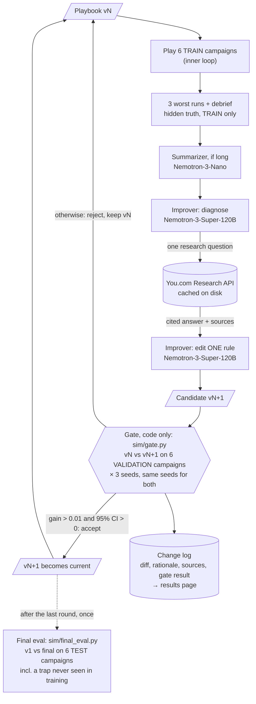

# Architecture

Two loops. The **inner loop** is the agent team playing one ad campaign by following the current playbook. The **outer loop** is the team improving itself: it studies its worst campaigns, proposes one playbook edit, and keeps the edit only if a code gate measures an improvement on campaigns the improver never studied.

Everything that decides what counts as better (simulator, score, gate, final eval) is plain code. Models play campaigns and propose edits; they never score anything.

## 1. Inner loop: one campaign

- **Actions:** `shift_budget` (to any line item), `pause`, `rotate_creative`, `set_holdout`. They apply to the next week.
- **What agents see** is shaped like Meta Insights and Google Ads reports: spend, platform-attributed purchases, CPA, CTR, CPM, CPC, frequency (Meta), search impression share (Google), ROAS, and holdout lift estimates for line items they chose to test. Holdouts cost real conversions.
- **If a model call fails**, the failure is logged and the campaign continues on its current budgets. The gate counts crashes.

## 2. Outer loop: Version N → N+1

- **Three-way split:** the improver studies **train**, the gate decides on **validation**, and **test** is used once at the end for the before/after score.
- **The test set contains a trap variation the team never trained on:** brand search is genuinely incremental in train and validation but over-credited in test (as in eBay's paid-search experiment). A team that memorized "brand is good" fails; a team that learned "test cheap last-click items before scaling" passes.
- **You.com only shapes which edit is proposed.** Whether it is kept is decided by the gate on the deterministic simulator. Answers are cached, so reruns see the same research.

## Agents

| Agent | Model | When it runs | Reads | Writes | Never sees |
|---|---|---|---|---|---|
| Planner | `nvidia/NVIDIA-Nemotron-3-Super-120B-A12B` | Before week 1 | Playbook, public campaign info | Plan: budget shares, holdouts, hypotheses | Hidden truth, score |
| Meta channel agent | `nvidia/Nemotron-3.5-Lightning-30B-A3B` | After weeks 1-3 | Playbook, latest observation for its line items, all CPAs | Actions on Meta prospecting / retargeting | Hidden truth, score |
| Google channel agent | `nvidia/Nemotron-3.5-Lightning-30B-A3B` | After weeks 1-3 | Same, for Google non-brand / brand | Actions on Google line items | Hidden truth, score |
| Verifier | `nvidia/Nemotron-3-Nano-Omni-Reasoning-30B-A3B` | Before week 1 and after week 4 | Playbook and campaign; final observation | Definition of done; verdict | Hidden truth, score |
| Summarizer | `nvidia/NVIDIA-Nemotron-3-Nano-30B-A3B` | Each improvement round, if the failure report is long | Worst train runs | Compressed post-mortem | Validation and test campaigns |
| Improver | `nvidia/NVIDIA-Nemotron-3-Super-120B-A12B` | Each improvement round (2 calls) | Playbook, 3 worst **train** runs with hidden truth, earlier edits, one You.com answer | One playbook edit + rationale + sources | Validation and test campaigns |

All models run on Crusoe Managed Inference at temperature 0, and the model configuration is fixed across a gate comparison, so the gate measures the playbook edit, not sampling.

## Code components (no models)

| Component | File | Role |
|---|---|---|
| Simulator | `sim/simulator.py` | 4 line items × 4 weekly checkpoints; 6 research-based traps from 4 mechanisms ([sim_calibration.md](sim_calibration.md)) |
| Score | `sim/simulator.py: score()` | True incremental conversions ÷ best possible for the budget, from hidden truth |
| Validators | `agents/schemas.py` | Reject malformed plans and actions before they reach the simulator |
| Gate | `sim/gate.py` | Paired comparison on validation; accept/reject |
| Improvement loop | `improve/loop.py`, `run_improvement.py` | Rounds of train → improver → gate → keep or revert |
| Research tool | `improve/research.py` | You.com Research/Search with disk cache |
| Final eval | `sim/final_eval.py` | One-time v1 vs final on test |
| Run store | `store/` | SQLite record of runs, model calls, actions, change log; hidden truth readable only via `store/truth.py` |
| Results page | `report/` | Static HTML: score per round, accepted/rejected edits with diffs, test before/after |
| Backends | `backends/` | Simulator today; a paused-by-default Meta backend is the next step |
