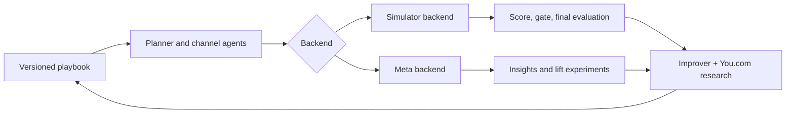

# Simulator and Meta Integration Plan

## Goal

Run one agent workflow against either a deterministic simulator or live Meta campaigns. The workflow shares playbooks, plans, actions, and observation shapes. Simulator scores remain the only mechanism for the automated Version N+1 gate; live campaigns report platform metrics and experiment results separately.



## 1. Shared backend contract

Create these modules:

```text
backends/
  base.py          # CampaignBackend protocol and shared schemas
  simulator.py     # Adapter around sim.Simulator
  meta.py          # Meta Graph API implementation
```

Both backends implement:

- `apply_plan(plan)`
- `observe()`
- `act(action)`
- `advance()`
- `done`

All actions return the normalized result shape:

```json
{"ok": true, "error": null}
```

The plan, action, and observation shapes are already defined and built: `sim/interface.py` is the canonical contract (`LINE_ITEMS`, `ACTION_TYPES`, the `PLAN`/`ACTIONS`/`OBSERVATION` docstrings), and `sim/simulator.py` implements it for the simulator backend (`generate_campaigns`, `Simulator.apply_plan/observe/act/step/done/debrief`, `score`). `backends/simulator.py` is a thin adapter that renames `step()` to `advance()` to match the shared protocol — it should not re-derive the schema. `backends/meta.py` converts raw Graph API and Insights responses into that same schema.

## 2. Meta backend

Refactor reusable code from `ad_swarm_full.py` into `backends/meta.py`:

- Graph API client and error handling
- Account discovery
- Campaign, ad-set, creative, and ad creation
- Insights polling
- Persistent live run state

Map currently supported shared line items to Meta ad sets:

| Shared line item | Meta implementation |
|---|---|
| `meta_prospecting` | Broad or interest-based prospecting ad set |
| `meta_retargeting` | Custom-audience retargeting ad set |
| `google_nonbrand` | Unsupported by the Meta backend |
| `google_brand` | Unsupported by the Meta backend |

The Meta backend must reject Google actions with a clear error. It must not silently ignore them.

### Action translation

| Shared action | Meta operation |
|---|---|
| `shift_budget` | Update source and destination ad-set budgets |
| `pause` | Pause an ad set |
| `rotate_creative` | Create or attach an approved replacement creative |
| `observe` | Normalize Meta Insights into shared history rows |
| `advance` | Schedule or wait for the next checkpoint window |

Initially, `set_holdout` should return an unsupported-action error in live mode. Implement it later through a Meta Conversion Lift experiment or a properly designed audience split. Live lift results will not be immediately equivalent to the simulator's holdout observations.

## 3. Agent package

Create:

```text
agents/
  models.py        # Crusoe client, model routing, retries, JSON extraction
  planner.py       # Initial plan generation and validation
  channel.py       # Checkpoint actions
  verifier.py      # Definition of done and final interpretation
  improver.py      # One playbook edit per round
  runner.py        # Shared run(version, backend) orchestration
```

Use the following NVIDIA model routing:

```python
MODELS = {
    "planner": "nvidia/NVIDIA-Nemotron-3-Super-120B-A12B",
    "channel": "nvidia/Nemotron-3.5-Lightning-30B-A3B",
    "verifier": "nvidia/Nemotron-3-Nano-Omni-Reasoning-30B-A3B",
    "summarizer": "nvidia/NVIDIA-Nemotron-3-Nano-30B-A3B",
    "improver": "nvidia/NVIDIA-Nemotron-3-Super-120B-A12B",
    "visual_reviewer": "nvidia/NVIDIA-Nemotron-3.5-Super-VL",
}
```

`improver.py` gives its model web access through the already-built You.com tool in `improve/research.py`: `RESEARCH_TOOL` (OpenAI-format tool definition) is passed in the improver's tool list, and a tool call resolves through `research(question)` (Research API, `research_effort="lite"`, ~6-8s, cited) or `search(query)` (~1s, raw snippets) — both disk-cached under `research/cache/` and both returning `{answer, sources, cached, [error]}`. `format_for_prompt(result)` renders a cited block for the prompt. At most one research call per improvement round, matching the brief's budget. The `summarizer` model can condense a long `research()`/`search()` answer plus a failure trace before it reaches the improver, but it must not call You.com itself — one call per round means one call total, not one per model. Set `YDC_DISABLED=1` to run the "improver without You.com" comparison without touching the cache.

Validate all plan and action JSON in code before passing it to either backend. Record the model, prompt version, settings, raw output, and action result in the run trace.

## 4. Simulator workflow first

Implement `agents.runner:run(version, sim)` as the `runner` plug-in that `improve/loop.py:improve()` and `sim/gate.py:evaluate_version()` already call by import string (`--runner agents.runner:run`, per `run_improvement.py`).

1. Read the versioned playbook.
2. Ask the Planner for an initial plan.
3. Call `apply_plan`.
4. At each checkpoint, ask channel agents for allowed actions.
5. Append plans, action results, and agent reasoning to `sim.trace`.
6. Ask the Verifier for its final assessment.

Use `temperature=0` during gate and final-evaluation runs. Keep model configuration fixed while comparing playbook versions so the gate measures the playbook edit rather than sampling or a model change.

## 5. Self-improvement loop

Reuse the existing, already-built improvement framework rather than re-deriving it:

- `sim/gate.py:evaluate_version(runner, version, split, ...)` runs the runner over a split's campaigns × seeds in parallel (16 concurrent) and returns per-run scores; `run_gate(runner, base_version, cand_version, ...)` pairs base vs. candidate on validation (same seeds, `temperature=0`) and calls `decide()` — accept only if mean score improves by more than `MARGIN` and the 95% CI excludes 0.
- `improve/loop.py:improve(runner, improver, start, name, rounds, ...)` is the round driver: it runs train campaigns, builds the `worst_runs()` failure summary (score, hidden truth via `sim.debrief()`, weekly metrics, agent trace), calls the `propose_edit` plug-in (`agents.improver:propose_edit`, implementing `improver.py`), writes the candidate to `runs/<name>/candidates/roundN.md`, runs the gate, and on accept promotes it to `runs/<name>/playbooks/v{n}.md`, logging every round to `runs/<name>/changelog.jsonl`.
- `agents.improver:propose_edit(playbook, failures, history) -> {"new_playbook", "summary", "rationale", "sources"}` is the function the loop calls. This is where the Super Improver model runs, with `summarizer` optionally condensing `failures`/`history` first, and with `RESEARCH_TOOL` (section 3) available for one You.com call per round — `sources` in the return value should be the URLs `research()`/`search()` returned, not invented citations.
- `sim/final_eval.py:final_eval(runner, v1, final, out_path=...)` runs Version 1 vs. the final accepted version once on the test split (refuses to overwrite `out_path`) and `sim/baselines.py` gives the non-AI reference scores (equal split, naive last-click, smart holdout) to compare against.
- Entry point: `run_improvement.py --name main --rounds 6 --runner agents.runner:run --improver agents.improver:propose_edit`.

The improver edits versioned Markdown playbooks, rather than changing Python strategy logic.

## 6. Unified CLI

Provide commands similar to:

```bash
# One simulated campaign
python ad_swarm.py simulate run --playbook playbooks/v1.md --split train

# Full Version N+1 loop (delegates to run_improvement.py / improve/loop.py:improve)
python ad_swarm.py simulate improve --name main --rounds 6

# Rebuild the results page for a run (delegates to report/build_page.py:build)
python ad_swarm.py simulate report --name main --watch

# Create a live campaign without activating it
python ad_swarm.py live create --playbook runs/main/playbooks/v3.md --paused

# Observe live results at a checkpoint
python ad_swarm.py live observe --run-id <run_id>

# Let channel agents apply live changes
python ad_swarm.py live checkpoint --run-id <run_id>
```

Campaign activation must require a separate explicit `--activate` command. Creation remains paused by default.

## 7. Separate records and measurements

```text
runs/<name>/                # Simulator playbooks, candidates, gate log, final evaluation (improve/loop.py)
live_runs/<run_id>.json     # Meta IDs, budget mapping, checkpoint state, live actions
```

Never include live observations in simulator validation or test scores. Live campaign outcomes can inform a future playbook proposal, but only the simulator gate accepts or rejects the proposal.

`report/build_page.py:build(name, final_path=None)` renders `runs/<name>/index.html` from the changelog and final eval — already built, static HTML, no server. Point it at `live_runs/<run_id>.json` as a second, clearly-labeled data source once the Meta backend exists, so the page can show simulator-decided playbook history next to live performance without implying the live numbers decided anything.

## 8. Visual review

Use `nvidia/NVIDIA-Nemotron-3.5-Super-VL` only after a live creative image or video frame exists. It can review whether the asset shows the product, price anchor, hook, and call to action specified in the brief. The simulator loop does not use it because it has no visual inputs.

## Delivery sequence

1. Create the shared backend contract (`backends/base.py`, `backends/simulator.py`) as a thin adapter over the already-built `sim/interface.py` and `sim/simulator.py` — no new schema work.
2. Implement the model client (`agents/models.py`) and the simulator runner (`agents/runner.py`), matching the `runner(version, sim)` signature `improve/loop.py` and `sim/gate.py` already call.
3. Add Planner, Channel, Verifier, and trace logging.
4. Implement the NVIDIA-based Improver (`agents/improver.py`) wired to `improve/research.py`'s `RESEARCH_TOOL`/`research()`/`search()`, with the `summarizer` model condensing failures/research before the Improver call.
5. Complete one simulated improvement run through the existing gate and loop (`run_improvement.py` → `improve/loop.py:improve` → `sim/gate.py:run_gate`), through to `sim/final_eval.py:final_eval` and the results page (`report/build_page.py:build`).
6. Refactor the current Meta code (`ad_swarm_full.py`) into a paused-campaign backend (`backends/meta.py`).
7. Add live observation, budget-shift, pause, and creative-rotation actions, so the agents can eventually pull real Meta media data through the same `observe()`/`act()` contract instead of simulator rows.
8. Add live holdout experiments (Meta Conversion Lift) and visual review (`visual_reviewer`).

The main implementation milestone is step 5: the NVIDIA-model swarm should improve a versioned playbook in the simulator — using the already-built gate, loop, research tool, and results page — before that playbook is deployed through the Meta backend. Steps 6-8 are the future-state path where the Meta backend becomes the agents' source of real media data, without ever feeding live numbers into the simulator gate.
